# Ferrari Distribution Network Optimization

**English** · [Italiano](README.it.md)

An integer-programming case study I built for **Investigación Operativa** during my Erasmus at Universidad Alfonso X el Sabio, Madrid (January 2025). It was my first project in Python: the course was largely theoretical, and the assignment was to find a real-world problem and apply the models to it. The project was graded **10/10**.

The model describes a two-stage distribution network — **Maranello → four regional hubs → 15 destination groups** — with capacity limits, demand bounds and flow conservation, and compares two transport-cost scenarios.

> [!NOTE]
> An independent student exercise inspired by public company information plus my own modelling assumptions. It is not affiliated with Ferrari and is not a model of the company's real operations.



## What's inside

| File | What it is |
| --- | --- |
| [`ferrari.ipynb`](ferrari.ipynb) | **The original submission**, unchanged: context, mathematical formulation, Pyomo implementation and results of both scenarios (Spanish) |
| [`data/ferrari.xlsx`](data/ferrari.xlsx) | The workbook I prepared the input data in: vehicle models, hubs and points of sale |
| [`model.py`](model.py) · [`run_scenarios.py`](run_scenarios.py) | The same model extracted from the notebook and made reproducible with the open-source HiGHS solver (added later) |
| [`results/scenarios.json`](results/scenarios.json) | Output of the reproducible runner |
| [`ASSUMPTIONS.md`](ASSUMPTIONS.md) | Data provenance, inconsistencies in the original tables and what the results can and cannot show |

## The model

- **Decisions:** 52 integer variables for model-to-hub shipments, 15 for hub-to-destination shipments.
- **Constraints:** shipment bounds, hub and destination capacities, flow conservation at each hub.
- **Objective:** maximize assumed vehicle values minus transport costs. The notebook calls this *ganancia*; it is not a verified profit figure.
- **Scenario 2:** the Maranello → North America transport coefficient rises from 0.00015 to 0.00035 EUR/(kg·km), everything else unchanged. A sensitivity exercise, not evidence of real savings.

## The data

`data/ferrari.xlsx` has three tables:

- **coches** — 13 models with their product line and estimated deliveries per region, 2023 and 2024.
- **hubs** — the four regional hubs with capacity, deliveries, forecasts, distance from Maranello and transport coefficient.
- **pos** — 15 destination groups with number of points of sale, capacity, deliveries, distance from their hub and coefficient.

Regional totals come from Ferrari's [2023 Annual Report](https://www.ferrari.com/en-EN/corporate/financial-documents?year=2023); the split by model, capacities, distances and coefficients are my assumptions.

## Run it

Requires Python 3.9 or later. The original notebook is in Spanish.

```sh
python3 -m venv .venv
source .venv/bin/activate
pip install -r requirements.txt
python run_scenarios.py
```

The runner prints both distributions, checks every constraint and writes `results/scenarios.json`. The original notebook used GLPK; to rerun it as submitted, install Jupyter and the `glpsol` executable.

## What came next

A year later, in the *Laboratorio di Strumenti di Ottimizzazione* at the University of Bologna, I went back to Python and Pyomo more systematically: knapsack, bin packing, graph colouring, minimum spanning trees, shortest paths. Those notebooks are in my [university repository](https://github.com/CometaSensitiva/university/tree/main/3-anno/laboratorio-strumenti-ottimizzazione).

## Sources

- Ferrari N.V., *2023 Annual Report and Form 20-F* — [financial documents](https://www.ferrari.com/en-EN/corporate/financial-documents?year=2023)
- José Niño Mora, *Introducción a la optimización de decisiones* (2021)

Original academic work: Michele Mazza, January 2025. Ferrari names and trademarks belong to their owners.
